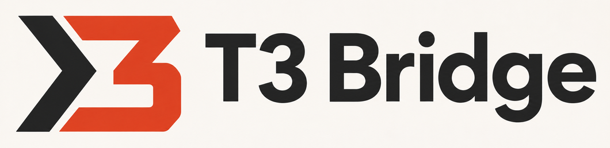
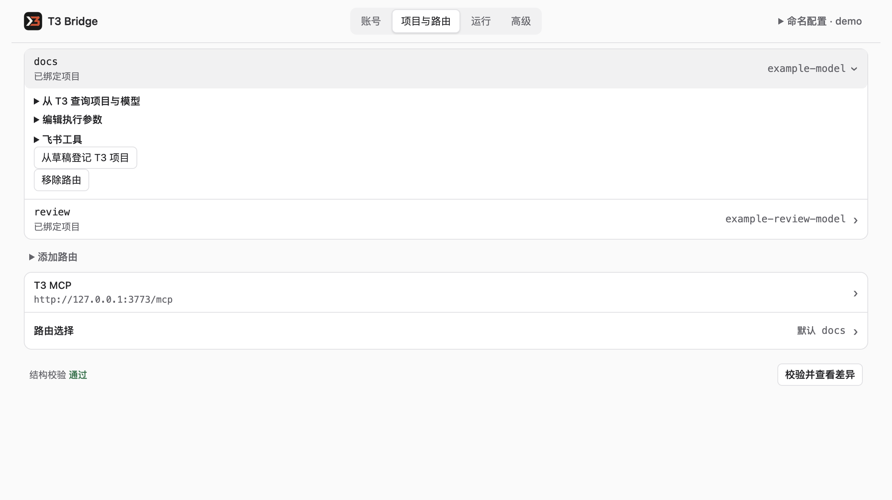

# T3 Bridge

English | [简体中文](README.zh-CN.md)



T3 Bridge connects Feishu and Lark chats to [T3 Code](https://github.com/pingdotgg/t3code) sessions. Feishu delivers messages, progress, and results. T3 Code runs tasks and manages sessions and approvals. The Bridge selects a configured route and keeps a durable receipt for each turn.

Inspired by [lark-channel-bridge](https://github.com/zarazhangrui/lark-coding-agent-bridge).

- Send direct messages, group messages, quoted messages, images, and files, and continue an existing T3 session.
- Bind Feishu or Lark apps by QR code. A single process can receive messages for multiple apps and respond to mentions in authorized cloud document comments.
- Configure a T3 environment, project, driver, provider, model, options, and access policy for each route. Routes can point to linked T3 environments.
- Follow progress and results in Feishu cards, stop a run, request an independent review, or read the redacted full response.

## Screenshots

[](docs/screenshots/web-workspace.png)

[Web workspace](docs/screenshots/web-workspace.png) · [macOS desktop workspace](docs/screenshots/macos-workspace.png) · [Terminal workspace](docs/screenshots/terminal-workspace.png) · [Feishu `/help`](docs/screenshots/feishu-help.png)

The configuration workspaces show a demo profile.

## What is HomeOps?

HomeOps is a separate operations system for self-hosted infrastructure. It runs health checks, tracks incidents and recovery, coordinates maintenance, and produces reports. With the optional integration, T3 Bridge can verify signed HomeOps events and route them to authorized Feishu conversations and T3 investigations. Regular Feishu-to-T3 Code chat works with a single route and requires no HomeOps setup. [HomeOps integration](docs/HOMEOPS-INTEGRATION.md)

## Quick start

You need a reachable T3 MCP service and a Feishu or Lark app with the required permissions. Use a dedicated app for your first end-to-end test. Builds from source require Go 1.25 or newer. [Build release packages](docs/RUNBOOK.md#build-release-packages)

```sh
go build -o bin/t3-bridge ./cmd/t3-bridge
bin/t3-bridge run
```

The same binary provides the receiver (`run`), terminal workspace (`config tui`), browser workspace (`config web`), and the native workspace (`config gui`) on desktop builds.

On the first interactive run, the terminal workspace opens if the selected configuration file is missing. Follow the prompts to bind the app, configure access, select a T3 route, and review and save the changes. When a managed receiver uses a different configuration file, pass the same `-config` path to the workspace. [Configuration guide](docs/CONFIGURATION.md)

In the workspace, use **T3 MCP → Use local T3** (`采用本机 T3`) to discover a local instance, or enter an endpoint manually. Confirm the private OAuth file location, request authorization, and approve it in T3. You can then look up the projects and models permitted by that authorization. [First T3 MCP authorization](docs/CONFIGURATION.md#first-t3-mcp-authorization)

```sh
bin/t3-bridge run -check
bin/t3-bridge config preflight -include-disabled
```

Preflight checks the saved app identity, T3 route, and local receiver locks. Add `-app-id APP_ID` to check a single app. In the workspace, open **Receiver preflight** (`接收预检`), prepare the app for receiving, and review and save the draft. Run `bin/t3-bridge run` to start the dedicated receiver. [Enable receiving per app](docs/CONFIGURATION.md#enable-receiving-per-app)

## Documentation

- [Configuration guide](docs/CONFIGURATION.md) covers profiles, credentials, access, routes, and configuration workflows.
- [Feishu slash commands](docs/FEISHU-COMMANDS.md) lists command syntax, permissions, and where to use each command.
- [Runbook](docs/RUNBOOK.md) covers builds, service management, chat commands, migration, and troubleshooting.
- [Architecture](docs/ARCHITECTURE.md) covers the receiver, persistent state, and configuration entry points.
- [Thread lifecycle](docs/THREAD-LIFECYCLE.md) explains naming, completion, and resuming T3 threads.

## License

T3 Bridge is available under the [MIT License](LICENSE). Third-party components and data are subject to their own terms. [Third-party notices](THIRD_PARTY_NOTICES.md)
