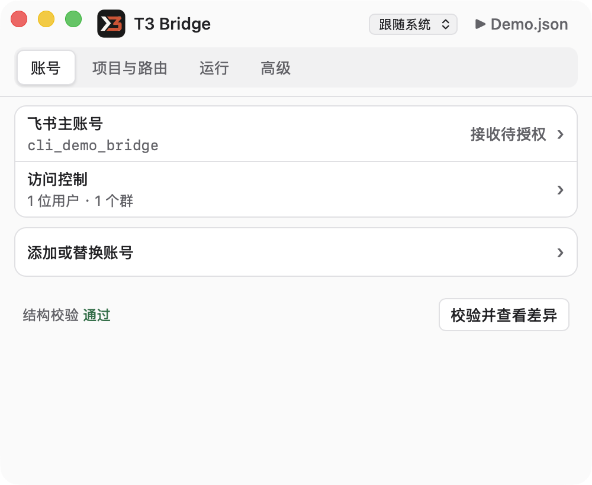

# T3 Bridge

[English](README.md) | 简体中文


T3 Bridge 把飞书消息接入 [T3 Code](https://github.com/pingdotgg/t3code) 的真实会话。飞书负责收发消息、显示进度和结果。T3 负责执行、会话和审批。Bridge 按配置选择目标并持久跟踪每一轮。

本项目受 [lark-channel-bridge](https://github.com/zarazhangrui/lark-coding-agent-bridge) 启发。

- 支持私聊、授权群聊、引用、图片和文件，可续接当前 T3 会话。
- 配置工作台支持飞书／Lark 扫码绑定。同一进程可接收多个 App ID，也可在授权云文档的评论中 @ 机器人。
- 每条路由显式声明 T3 环境和项目、driver、provider、模型、选项、权限和用户范围。一个实例即可接入多个已关联的 T3 环境。
- 飞书卡片显示运行进度和结果，支持停止、独立复核以及读取脱敏全文。
- 普通对话可以从一个默认路由起步。意图分类器和 [HomeOps 集成](docs/HOMEOPS-INTEGRATION.zh-CN.md)可按需配置。

## 界面截图

<a href="docs/screenshots/macos-workspace.png"></a>

[Web 工作台](docs/screenshots/web-workspace.png) · [终端工作台](docs/screenshots/terminal-workspace.png) · [飞书 `/help`](docs/screenshots/feishu-help.png)

配置工作台截图使用演示配置。

## HomeOps 是什么

HomeOps 是面向自托管基础设施的独立运维系统，负责健康检查、故障与恢复跟踪、维护协调和报告。T3 Bridge 接入 HomeOps 后，可以把经过签名验证的事件带入获授权的飞书会话和 T3 调查。普通飞书与 T3 Code 桥接无需安装或配置 HomeOps。

## 快速开始

### 用 AI Agent 安装

复制这句提示词给你的 Agent。

```text
请按 https://github.com/HessianZ/t3-bridge/blob/main/README.zh-CN.md#快速开始 在本机安装 T3 Bridge，选择匹配系统和架构的 ZIP 或从源码构建，用 --version 核对安装结果，并引导我完成飞书或 Lark 绑定及 T3 MCP 授权。
```

### 手动安装

从 [Releases](https://github.com/HessianZ/t3-bridge/releases/latest) 下载与系统和架构匹配的 ZIP。完整解压后，在解压目录执行 `bin/t3-bridge run`，Windows 下执行 `.\bin\t3-bridge.exe run`。

需要可访问的 T3 MCP 服务，以及一个具备所需权限的飞书应用。T3 可用本机回环或 HTTPS 直连。先用独立应用验证收发。从源码构建需要 Go 1.25 或以上。 [构建发布包](docs/RUNBOOK.zh-CN.md#构建发布包)

在源码目录下执行以下命令即可构建并启动。

```sh
go build -o bin/t3-bridge ./cmd/t3-bridge
bin/t3-bridge run
```

一个桌面 ZIP 即可使用全部入口。同一个 `bin/t3-bridge` 提供 `run` 后台接收、`config gui` 桌面窗口、`config web` 网页和 `config tui` 终端工作台。无桌面环境可以选 core ZIP，其中也包含 Web 和 TUI。

桌面和终端工作台默认跟随系统语言，Web 工作台跟随浏览器的语言偏好。可在工作台顶部选择「跟随系统」「English」或「简体中文」，也可在终端工作台主屏按 **F3** 切换。选择保存在本机。

首次在交互终端运行时，若没有配置文件，会打开终端工作台。按提示绑定飞书应用、配置 ACL 和 T3 路由，再核对差异后保存。受管实例使用安装时指定的配置路径。若它与默认配置不同，打开工作台时通过 `-config` 选同一份 JSON。 [配置说明](docs/CONFIGURATION.zh-CN.md)

首次连接本机 T3 时，在「T3 MCP」中点击「采用本机 T3」，审核运行文件与环境 ID。也可以手填端点。确认私有 JSON 令牌文件路径后，展开「申请 T3 授权」。在 T3 页面批准后，可查询并选择实际可用的项目和模型。 [首次授权步骤](docs/CONFIGURATION.zh-CN.md#t3-mcp-首次授权)

```sh
bin/t3-bridge run -check
bin/t3-bridge config preflight -include-disabled
```

预检可核对已保存的飞书身份、T3 路由和本机接收锁。加上 `-app-id APP_ID` 可只查该应用。首次启用时，从「接收预检」打开「按 App 准备启用接收」，检查通过后审阅并保存启用草稿。再执行 `bin/t3-bridge run` 启动独立测试接收端。 [按应用启用接收](docs/CONFIGURATION.zh-CN.md#按应用启用接收)

- [飞书斜杠命令](docs/FEISHU-COMMANDS.zh-CN.md)列出完整语法、权限和适用场景。
- [运行指南](docs/RUNBOOK.zh-CN.md)涵盖飞书命令、Linux 部署及切换条件。
- [架构说明](docs/ARCHITECTURE.zh-CN.md)介绍 CLI、持久状态和 Web 配置入口。
- [线程生命周期](docs/THREAD-LIFECYCLE.zh-CN.md)说明线程命名、收口和续聊。
- [HomeOps 可选集成](docs/HOMEOPS-INTEGRATION.zh-CN.md)说明维护、事件和报告接口。

## 许可证

T3 Bridge 自有部分采用 [MIT 许可证](LICENSE)。第三方组件及数据适用各自的许可。 [第三方声明](THIRD_PARTY_NOTICES.md)
