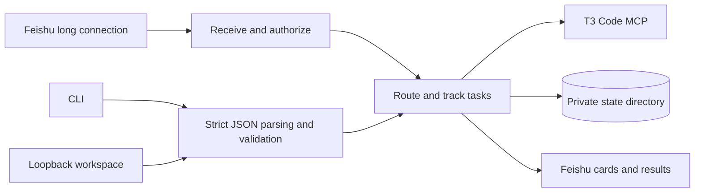

# Architecture

English | [简体中文](ARCHITECTURE.zh-CN.md)

`cmd/t3-bridge` handles CLI arguments, configuration selection, process lifecycle, and offline maintenance. `internal/bridge` handles configuration, Feishu reception, routing, T3 calls, work queues, and local state.

- `config_read.go` and `config.go` read and validate JSON. Configuration defines targets, models, permissions, and secret file paths. A running receiver uses the configuration snapshot loaded at startup.
- `lark.go`, `access.go`, and `session_control.go` receive messages, check access, and handle session commands. `router.go` resolves the current binding, an explicit route, or an allowed candidate.
- `comments.go` receives Feishu comment mentions. Comment quotes and replies use the same queue, T3 lifecycle, and durable delivery receipts. Replies stay in the source document.
- `meeting.go` handles per-app manual meeting control. Before a Feishu write, it persists the operator's direct chat, meeting number, and pending receipt. Leaving uses the long meeting ID returned by Feishu.
- `meeting_invite.go` verifies the account, invited bot, and inviter. It deduplicates by event and call ID, then atomically records a pending receipt and removes the call from the queue before dispatch. Inviters manage their meetings in direct chat.
- `meeting_content.go` sends bounded caption excerpts to an explicitly configured route. Meeting receipts bind to independent T3 tasks and reuse the queue, preflight, and stop behavior. Results return to the initiating direct chat.
- `meeting_live_captions.go` maintains a short-lived caption cache in each account's Store. Reconnects reuse the cache. Direct-chat commands merge live updates with paged readings. Ending or leaving a meeting clears its cache.
- `meeting_room.go` handles explicit in-meeting commands and verifies the speaker's app and route access. Room tasks use a separate session scope. Verified final results return to the meeting with stable UUIDs.
- `meeting_summary.go` persists a bounded transcript excerpt, requester, route, and recipient when a meeting ends. The worker reuses T3 task receipts and sends results with a stable UUID to the originating direct chat or the verified app owner.
- `config_feishu.go` supplies the same group lookup to all four configuration entry points and the Feishu `/invite all group` command. Selection updates a draft. The receiver applies live access changes.
- Live changes to groups, users, admins, and route ACLs go through the selected worker's private process registry. The worker checks the account binding, applies the same transaction used by chat commands, and publishes the updated access rules.
- A worker publishes connection state, task counts, and the dispatch concurrency budget to its private process registry about every five seconds. It keeps the latest 12 changes per app and writes observations to the process log. The workspace checks active processes and accounts and shows stale samples as unknown.
- `mcp.go` reads T3 identity, capabilities, and execution state. `engine.go` tracks submissions, runs, delegated tasks, and notifications. When submission or stop is ambiguous, it records a reconciliation state before any further action.
- `store.go` locks the private state directory and persists tasks, mappings, deduplication keys, and receipts. On restart, it resumes tracking from that state. [Thread lifecycle](THREAD-LIFECYCLE.md)
- `events.go`, `maintenance.go`, `investigation.go`, and `reporting.go` implement explicitly configured operations adapters. [HomeOps integration](HOMEOPS-INTEGRATION.md)

One process can run multiple app accounts. Each has its own Feishu long connection, ACL, queue, state directory, and MCP session. Request IDs remain distinct per App ID even when accounts share a T3 instance. Existing state retains its original identity and receipts.

## Configuration entry points

`t3-bridge config web` starts the Go workspace on a temporary `127.0.0.1` port. Native windows on macOS, Linux, and Windows embed the same workspace. TUI and CLI also work without a desktop. All four use embedded templates, strict Go JSON validation, and versioned saves.

Structured forms and `config patch` share the field update logic in `config_edit.go`. A candidate can be downloaded or saved after validation and diff preview. A save checks the source revision and backs up the previous version. Each named profile has its own JSON and state directory. Changing the default affects future profile selection. A managed service keeps the path selected at installation.

Tool identity checks call the local CLI configured for the route. Web and desktop use the launch URL fragment to establish the verification session. The credential stays in session storage for that workspace origin. Checks require a same-origin POST, a launch session, and the saved file revision. TUI and Web use the same Go probe and check the private file revision before and after it runs.

QR binding uses the official Feishu Go SDK and renders the QR code locally. Once confirmed, the App Secret goes into a private file. The draft stores its path.

**My groups** uses a locally installed `lark-cli` with user authorization. The entry points share private CLI configuration and device authorization tickets keyed by tenant and App ID. CLI configuration references the existing secret file. Listing groups, inviting the bot, and editing group ACLs each have their own permission checks. [lark-cli file references](https://github.com/larksuite/cli/blob/v1.0.96/internal/core/secret.go)

The receiver loads configuration on startup. Processes sharing a user configuration directory receive exclusively per tenant and App ID. Live concurrency, reply mode, progress, and ACL changes are persisted by the running receiver.
