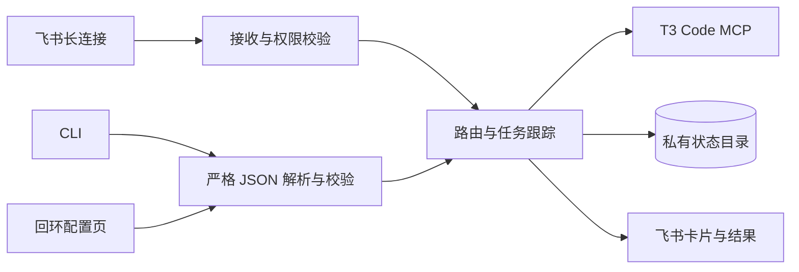

# 程序架构

[English](ARCHITECTURE.md) | 简体中文

`cmd/t3-bridge` 是程序入口，负责参数、配置选择、进程生命周期和离线维护命令。`internal/bridge` 实现配置、飞书接收、路由、T3 调用、工作队列及本地状态。

- `config_read.go` 和 `config.go` 读取并校验 JSON。目标、模型、权限和密钥路径由配置声明，运行实例在启动时取配置快照。
- `lark.go`、`access.go` 与 `session_control.go` 接收消息、检查权限并处理会话命令。`router.go` 根据当前绑定、显式路由和允许的候选选择目标。
- `comments.go` 接收飞书评论 @ 事件。评论引用和结果复用队列、T3 生命周期和持久发送回执，投递目标保留为原云文档。
- `meeting.go` 处理按账号启用的手动会议控制。飞书会议写请求开始前，先持久记录操作者私聊、会议号和待确认回执。离会复用飞书返回的长会议 ID。
- `meeting_invite.go` 接收经账号、受邀机器人和邀请人核对的事件。按事件和通话 ID 去重，提交前原子保存待核对回执并从队列移除通话 ID。邀请人可在私聊中管理其发起的会议。
- `meeting_content.go` 通过明确配置的路由处理有界字幕摘录。会议回执绑定独立 T3 任务，复用原任务队列、预检和停止。结果投递到发起人的私聊。
- `meeting_live_captions.go` 在各账号的 Store 内持有已跟踪会议的短期字幕缓存。长连接重建复用此缓存。私聊指令合并推送和按需分页结果，会议结束或离会后清理缓存。
- `meeting_room.go` 接收显式会中指令，核对实际发言人的应用和路由权限。会中任务使用独立会话范围，已核对的终态结果用固定 UUID 投递原会议。
- `meeting_summary.go` 在结束会议的 Store 事务中保存有界字幕、发起人、目标路由和接收人。工作进程复用 T3 任务回执。结果通过固定消息 UUID 发给原私聊或已核实的应用所有者。
- `config_feishu.go` 为四个配置入口和飞书 `/invite all group` 提供同一群列表查询。配置入口按所选账号查询，选择结果进入草稿，接收端命令负责即时群授权。
- 在线群授权、用户、管理员和逐路由授权经本机私有接收进程目录交给已选账号的 worker。接收端校验账号绑定，以飞书命令共用的事务保存授权并发布运行权限。Web、桌面、TUI 和 CLI 复用此通道。
- 运行诊断由接收 worker 向该进程的私有登记目录发布，约每 5 秒记录连接标记、任务计数和与派发规则共用的并发额度。每个 App 保留最近 12 条有界变化，新的观察同步写入现有进程日志。工作台核对仍有效的进程和账号，过期采样显示未知。
- `mcp.go` 负责 T3 身份、能力和执行状态的读取与调用。`engine.go` 跟踪一轮中的提交、运行、真实子任务和通知。发送或停止结果未知时保存待核对状态，避免重放。
- `store.go` 持有私有状态目录的独占锁，持久化任务、映射、去重记录和回执。重启根据已保存状态恢复。线程标题与收口规则见[线程生命周期](THREAD-LIFECYCLE.zh-CN.md)。
- `events.go`、`maintenance.go`、`investigation.go` 和 `reporting.go` 实现显式配置的监控适配。普通飞书会话无需这些外部依赖。

一个进程可以运行多个账号。每个账号有各自的飞书长连接、ACL、工作队列、状态目录和 MCP 会话。发送到同一 T3 的请求 ID 也按 App ID 区分，已有状态保留原身份和回执。

## 配置入口

`t3-bridge config web` 在 `127.0.0.1` 的临时端口启动 Go HTTP 配置工作台。macOS、Linux 和 Windows 的原生窗口嵌入同一工作台。TUI 与 CLI 在没有桌面的环境直接工作。四个入口都使用内置模板、Go 的严格 JSON 校验和版本化保存。

结构化表单和 `config patch` 使用 `config_edit.go` 的同一字段更新逻辑。候选配置经校验与差异预览后可下载或保存。保存检查源版本并备份上一版。命名配置各有自己的 JSON 和状态目录。设为默认只影响后续选取配置，后台服务固定使用安装时选择的路径。

工具身份核验会调用所选路由配置的本机 CLI。Web 和桌面由启动地址的片段建立核验会话，密钥留在该工作台来源的会话存储中。发起核验需要同源 POST、启动会话及所选文件的保存版本。TUI 和 Web 共用核验前后的私有文件版本校验，使用同一 Go 探针。

扫码流程使用飞书官方 Go SDK。二维码由本机生成。用户确认后，App Secret 保存到私有文件，草稿只保存引用路径。

「我的群」通过已安装的 `lark-cli` 获得用户授权。四个入口共用按租户和 App ID 绑定的私有 CLI 配置及设备授权票据。CLI 配置直接引用已有密钥文件。列群和邀请前核对应用所有者及所需权限。查看用户所在群、邀请机器人和配置群 ACL 是三个独立操作。 [lark-cli 文件引用契约](https://github.com/larksuite/cli/blob/v1.0.96/internal/core/secret.go)

运行实例在启动时读取配置。同一用户配置目录中的进程按租户与 App ID 互斥接收，防止重复执行一条消息。并发预算、回复模式、进度开关和动态 ACL 由运行中的 Bridge 持久化。
